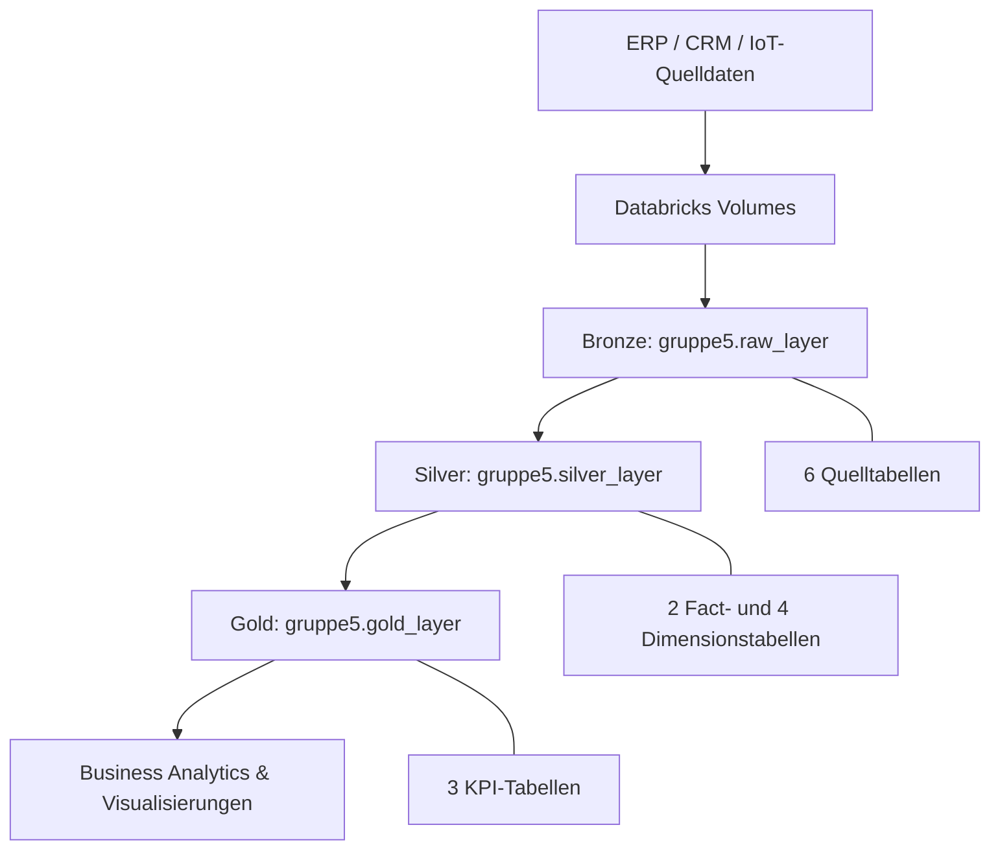
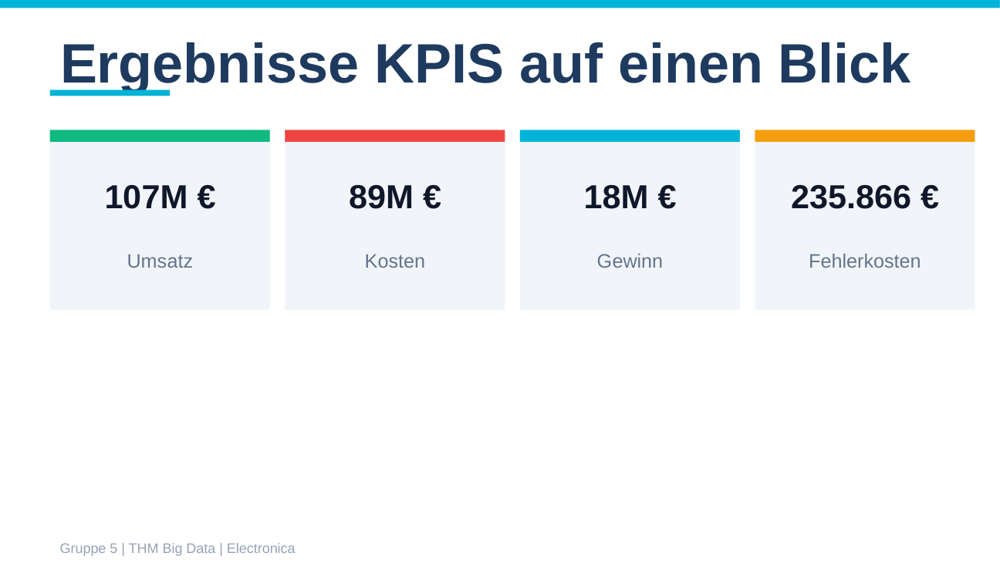
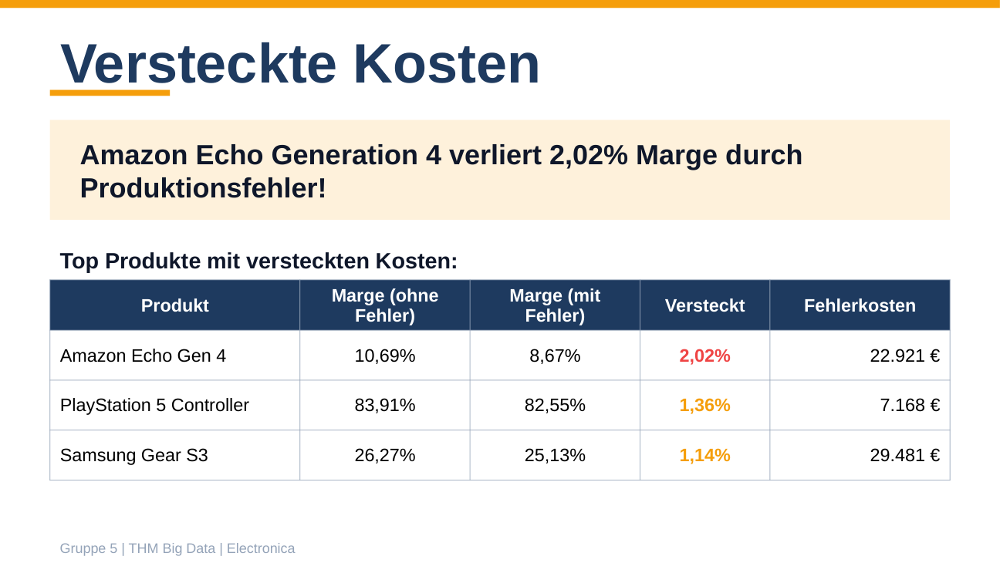
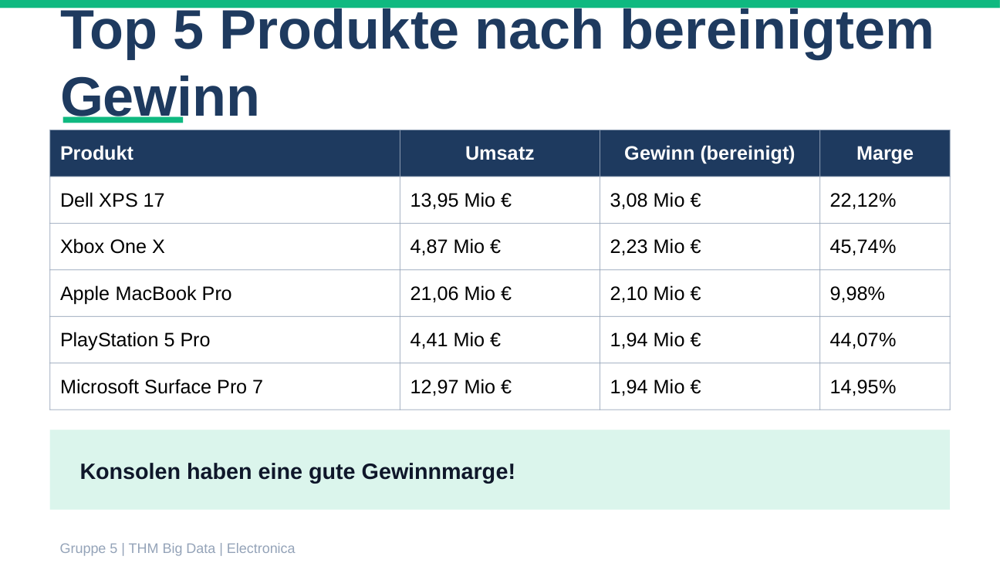
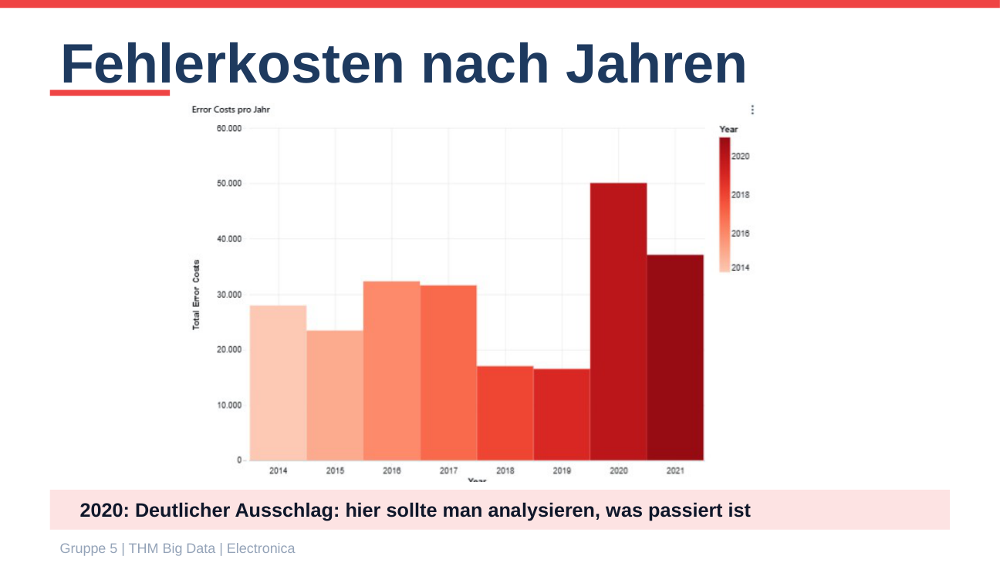
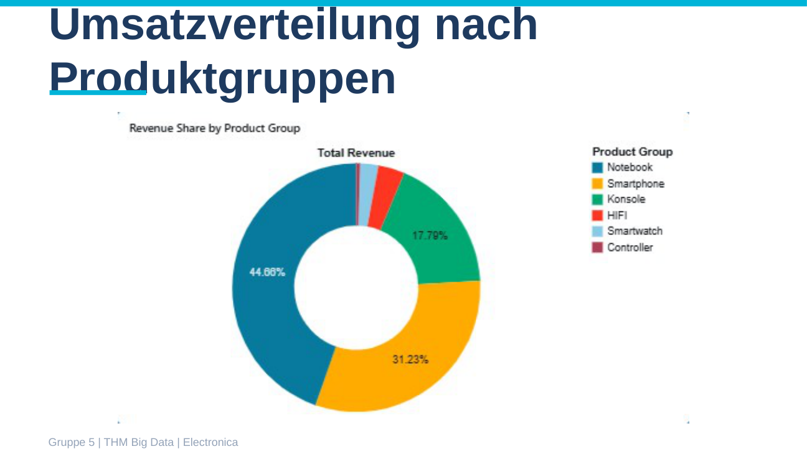
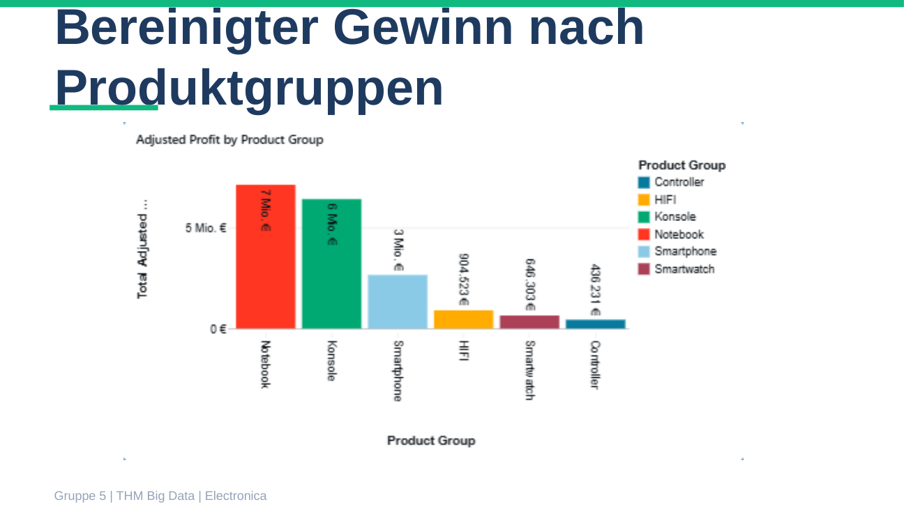
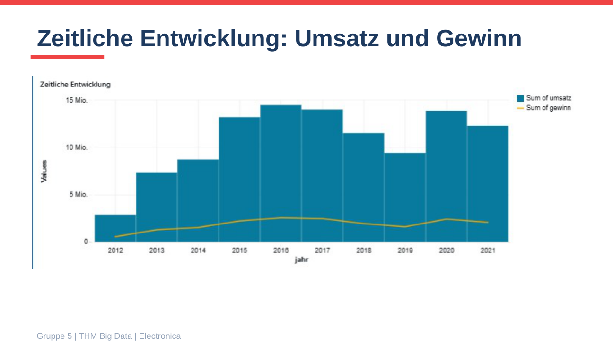
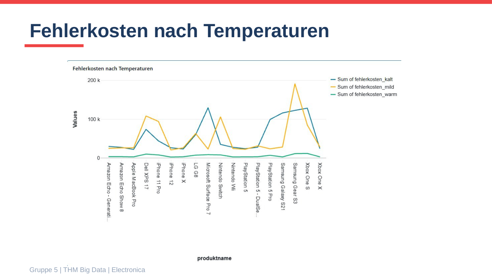

# 📊 Databricks Big Data – Electronica Fallstudie

> **Big Data & Business Analytics | Data Engineering mit Databricks SQL**  
> Studienprojekt im Modul **Big Data** · Technische Hochschule Mittelhessen (THM) · Gruppe 5 · WS 2025/26

## 🎯 Projektübersicht

In dieser Gruppen-Fallstudie wurde eine Datenpipeline in **Databricks** konzipiert und mit SQL für die Analyse von Vertriebs- und IoT-Produktionsdaten umgesetzt. Ziel ist es, Daten aus mehreren Quellsystemen zu verbinden und neben Umsatz und Gewinn auch die durch Produktionsfehler verursachten **versteckten Kosten** sichtbar zu machen.

Im Projekt wurden Rohdaten in Databricks bereitgestellt, im **Silver Layer** aufbereitet und im **Gold Layer** zu fachlichen KPI-Tabellen kombiniert. Ausgewählte Ergebnisse wurden in einer Management-Präsentation visualisiert.

## 🏗️ Architektur – Medallion Architecture



| Schicht | Datenobjekte | Zweck |
|---|---|---|
| **Bronze / Raw** | `dl_iot`, `dl_meldungen`, `dl_sps`, `dwh_kunde`, `dwh_produkt`, `dwh_verkauf` | Daten aus den Quellsystemen bereitstellen |
| **Silver** | `fact_produktion`, `fact_verkauf`, `dim_meldung`, `dim_anlage`, `dim_kunde`, `dim_produkt` | Datentypen, Nullwerte und Textfelder vereinheitlichen |
| **Gold** | `kpi_produkt_performance`, `kpi_linie_fehler`, `kpi_produkt_gesamt` | Umsatz-, Gewinn-, Margen- und Fehlerkostenanalysen |

> **Reproduzierbarkeit:** Die SQL-Dateien für Silver, Gold und Analysen sind vorhanden. Ein ausführbarer Bronze-Ingestion-Code und die sechs Original-Datendateien lagen in den bereitgestellten Unterlagen nicht vor. Zur vollständigen Ausführung werden diese Quelldaten und eine Databricks-Umgebung benötigt.

## 🛠️ Technologien

| Technologie / Konzept | Verwendung im Projekt |
|---|---|
| **Databricks** | Datenplattform, Tabellen und analytische Abfragen |
| **Databricks SQL** | Datenbereinigung, Transformationen, Joins und KPI-Berechnungen |
| **Medallion Architecture** | Strukturierung der Daten in Bronze, Silver und Gold |
| **Star Schema** | Modellierung von Fakten und Dimensionen für Vertrieb und Produktion |
| **IoT / IIoT-Daten** | Analyse von SPS-Meldungen und Produktionsfehlern |
| **Business Intelligence** | Business-KPIs, Produktanalysen und Ergebnisvisualisierung |

## ✨ Projektschwerpunkte

- **Datenintegration:** Kombination von Vertriebs-, Kunden-, Produkt- und Fertigungsdaten.
- **Datenqualität:** Überprüfung von Duplikaten, fehlenden Werten und Formaten; Bereinigung mit `TRIM`, `UPPER`, `CAST` und `COALESCE`.
- **Fact- und Dimensionstabellen:** Aufbau einer analytischen Datenbasis im Silver Layer.
- **KPI-Tabellen:** Berechnung von Netto-Umsatz, Kosten, Gewinn, Marge und Produktionsfehlerkosten.
- **Verknüpfung von Produktion und Vertrieb:** Bereinigter Gewinn und bereinigte Marge nach Berücksichtigung von Fehlerkosten.
- **Analysen:** Versteckte Kosten, profitable Produkte, problematische Produktionslinien und Rabatte nach Kundenklasse.

## 📈 Präsentierte Ergebnisse

Die folgenden Kennzahlen stammen aus der **Gruppenpräsentation** der Fallstudie; sie sind Projektergebnisse und keine aktuellen Unternehmenszahlen.

| Kennzahl | Präsentierter Wert |
|---|---:|
| Umsatz | ca. **107 Mio. €** |
| Kosten | ca. **89 Mio. €** |
| Gewinn vor Fehlerkosten | ca. **18 Mio. €** |
| Produktionsfehlerkosten | **235.866 €** |

Eine zentrale Erkenntnis: Für das untersuchte Produkt **Amazon Echo Generation 4** sinkt die ausgewiesene Marge laut Fallstudie von **10,69 %** auf **8,67 %**, sobald die zugeordneten Produktionsfehlerkosten berücksichtigt werden.

## 📊 Datenmodell und Kennzahlen

**Vertrieb:** `fact_verkauf` wird mit `dim_kunde` und `dim_produkt` analysiert.  
**Produktion:** `fact_produktion` wird mit `dim_anlage` und `dim_meldung` analysiert.  
**Kombinierte Auswertung:** Die Gold-Tabelle `kpi_produkt_gesamt` ergänzt die Produktperformance um Produktionsfehler und ihre Kosten.

```text
Netto-Umsatz       = Menge × Einzelpreis × (1 − Rabatt/100)
Produktkosten      = Menge × (Herstellkosten + Markenkosten)
Gewinn             = Netto-Umsatz − Produktkosten
Bereinigter Gewinn = Gewinn − Produktionsfehlerkosten
Bereinigte Marge   = Bereinigter Gewinn / Netto-Umsatz × 100
```

## 🚀 Entwicklungsschritte

1. Quelltabellen für Verkauf, Produkte, Kunden, SPS, Meldungen und IoT-Daten in Databricks bereitstellen.
2. Datenqualitätsprüfungen durchführen (Nullwerte, Duplikate, Formate).
3. **Silver Layer** als zwei Fakten- und vier Dimensionstabellen modellieren.
4. Fachliche KPIs im **Gold Layer** durch Joins und Aggregationen berechnen.
5. Vertriebsdaten mit Produktionsfehlern auf Produktebene verknüpfen.
6. Analyseabfragen für Managementfragen formulieren und Ergebnisse visualisieren.

## 📸 Screenshots aus der Gruppenpräsentation

### KPI-Überblick


### Versteckte Produktionskosten


### Top-Produkte nach bereinigtem Gewinn


### Fehlerkosten nach Jahren


### Umsatzverteilung nach Produktgruppen


### Bereinigter Gewinn nach Produktgruppen


### Zeitliche Entwicklung von Umsatz und Gewinn


### Fehlerkosten nach Temperaturen


## 📁 Repository-Struktur

```text
databricks-electronica-big-data/
├── README.md
├── README_EN.md
├── .gitignore
├── sql/
│   ├── 01_silver_layer.sql
│   ├── 02_gold_layer.sql
│   ├── 03_analysen.sql
│   └── 04_pruefungen.sql
├── docs/
│   ├── datenmodell.md
│   ├── setup.md
│   ├── projektkontext.md
│   └── vor-veroeffentlichung.md
└── screenshots/
    ├── 01-kpi-overview.png
    ├── 02-hidden-production-costs.png
    ├── 03-top-products.png
    ├── 04-defect-costs-by-year.png
    ├── 05-revenue-by-product-group.png
    ├── 06-adjusted-profit-by-product-group.png
    ├── 07-revenue-profit-over-time.png
    └── 08-errors-by-temperature.png
```

## ▶️ SQL in Databricks ausführen

Die ausführbaren SQL-Abfragen basieren auf der bereitgestellten Gruppendokumentation. Vorgehensweise und Voraussetzungen stehen in [docs/setup.md](docs/setup.md). Für eine öffentliche Wiederverwendung müssen die Quelltabellen aus eigener, freigegebener Datenbasis angelegt werden; der im Studienprojekt verwendete `gruppe5`-Katalog ist keine allgemein zugängliche Datenquelle.

## 📌 Projektkontext & Hinweise

- **Art:** Hochschul-Gruppenprojekt (keine Einzelentwicklung).
- **Grundlage:** Eigene Präsentation und SQL-Dokumentation der Gruppe 5.
- **Status:** Dokumentierter Databricks-Prototyp mit KPI-Analysen. Ohne Originaldaten ist keine vollständige lokale Ausführung garantiert.
- **Nicht enthalten:** Dozenten-Unterlagen, Original-Rohdatensätze, API-Keys, Anmeldedaten oder Workspace-Exporte.
- **Veröffentlichung:** Vor Umstellung auf *Public* die Freigabe der Teammitglieder und die Nutzungsrechte der verwendeten Screenshots prüfen.

**Modul:** Big Data · THM, Friedberg  
**Studiengang:** Wirtschaftsinformatik (B.Sc.)
