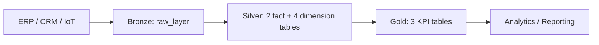
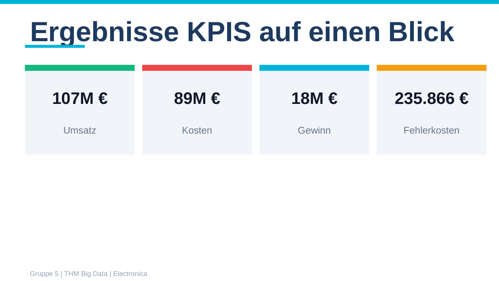
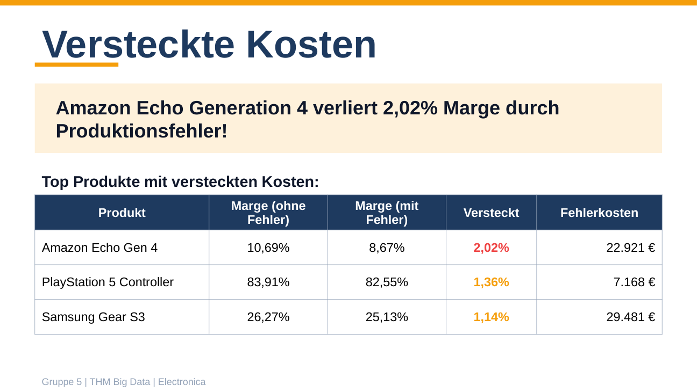
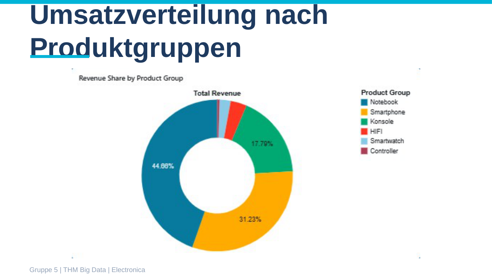

# 📊 Databricks Big Data – Electronica Case Study

> **Databricks SQL | Data Engineering | Business Intelligence**  
> Academic team project, Business Informatics (B.Sc.), Technische Hochschule Mittelhessen (THM), Group 5, Winter 2025/26.

## Project overview

This case study explores how sales and IoT production datasets can be integrated in Databricks to reveal production-related costs that are not visible in conventional profitability reporting. We documented a **Bronze → Silver → Gold** data pipeline, a dimensional model, SQL transformations, KPI tables, and management reporting.

## Architecture

| Layer | Tables | Purpose |
|---|---|---|
| Bronze | `dl_iot`, `dl_meldungen`, `dl_sps`, `dwh_kunde`, `dwh_produkt`, `dwh_verkauf` | Raw source data |
| Silver | `fact_produktion`, `fact_verkauf`, `dim_meldung`, `dim_anlage`, `dim_kunde`, `dim_produkt` | Transform and standardize |
| Gold | `kpi_produkt_performance`, `kpi_linie_fehler`, `kpi_produkt_gesamt` | Business KPIs |

## Technologies and methods

Databricks, Databricks SQL, Medallion Architecture, dimensional modeling, SQL transformations and joins, IoT production data, BI analytics.

## Reported team findings

According to the group's case-study presentation: **~€107M revenue**, **~€89M cost**, **~€18M pre-defect profit**, and **€235,866 in production defect costs**. The case-study margin of the Amazon Echo Gen 4 drops from **10.69%** to **8.67%** when its attributed production defect costs are considered. These values are not independent real-company financial statements.

## Screenshots

## Code

- [`sql/01_silver_layer.sql`](sql/01_silver_layer.sql): two fact tables and four dimensions.
- [`sql/02_gold_layer.sql`](sql/02_gold_layer.sql): three KPI tables.
- [`sql/03_analysen.sql`](sql/03_analysen.sql): analysis queries.
- [`sql/04_pruefungen.sql`](sql/04_pruefungen.sql): validation queries.

## Limitations

The source materials do **not** include executable Bronze ingestion code, the original input datasets or a Databricks workspace export. These files require a Databricks SQL environment with matching raw-layer tables. Screenshots come from the group's own presentation; original course slides are not included. Publication rights and team consent should be confirmed before making the repository public.

[🇩🇪 Full German project description](README.md) · [Setup instructions](docs/setup.md)
